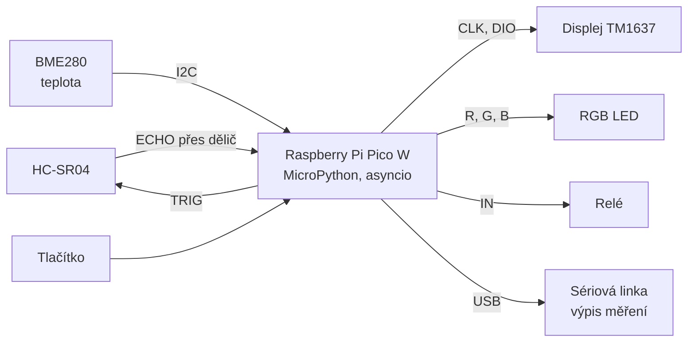

# Ultrasonic distance instrument

Bezkontaktní měřič vzdálenosti s ultrazvukovým senzorem HC-SR04 na **Raspberry Pi Pico W** v **MicroPythonu**.
Vzdálenost se zobrazuje na 4místném displeji, RGB LED ukazuje blízko/daleko a když je překážka moc blízko,
sepne relé (např. výstražné světlo). Teplota ze senzoru BME280 zpřesňuje výpočet rychlosti zvuku.

> Projekt do kurzu MicroPython, téma 6 – *Ultrasonic distance instrument*.

---

## 1. O projektu

- **Problém:** Bezkontaktní měření vzdálenosti k překážce a jasná indikace „blízko / daleko“ (jako parkovací senzor).
- **Klíčová funkce (minimum):** Měření vzdálenosti 10× za sekundu, zobrazení v cm na displeji TM1637
  a barevná indikace RGB LED (zelená / žlutá / červená).
- **Rozšíření (až po splnění minima):**
  - relé sepne při vzdálenosti pod 30 cm (prahový alarm),
  - korekce rychlosti zvuku podle teploty z BME280,
  - tlačítko přepíná displej mezi vzdáleností a teplotou.

## 2. Tým a rozdělení odpovědností

> Návrh rozdělení – upravte podle dohody. Každý člen musí rozumět celému systému.

| Člen | Hlavní zodpovědnost |
| :--- | :--- |
| **Marcel Hrbáček** | HC-SR04 (třída `HCSR04`, dělič napětí, měření přesnosti) a BME280 (třída `BMP280`) |
| **Matěj Dostál** | Displej TM1637 (třída `TM1637`) a tlačítko, schéma zapojení, poster |
| **Matouš Dorazil** | RGB LED (`RgbLed`), relé (`Relay`), hlavní program `main.py`, Sphinx dokumentace, video |

## 3. Hardware

| Komponenta | Typ / označení | Počet | Poznámka |
| :--- | :--- | :---: | :--- |
| Řídicí deska | Raspberry Pi Pico W + rozšiřující deska | 1 | logika 3,3 V |
| Ultrazvukový senzor | HC-SR04 | 1 | napájení 5 V, rozsah 2–400 cm, ECHO má 5 V |
| Dělič napětí | rezistory 1 kΩ + 2 kΩ | 1 sada | ECHO 5 V → ~3,3 V pro Pico |
| Displej | 4místný 7segmentový displej s TM1637 | 1 | piny CLK, DIO, GND, 5V – napájet z **3,3 V** |
| Teplotní senzor | BME280 / BMP280 (modul GYBMEP) | 1 | I2C, adresa 0x76 nebo 0x77 |
| RGB LED | Iduino 3-color LED modul | 1 | společná katoda, rezistory na modulu (piny R, G, B, −) |
| Relé | 1 Relay Module, SRD-05VDC-SL-C | 1 | napájení 5 V, ovládání pinem IN |
| Tlačítko | mikrospínač 12 × 12 mm | 1 | proti GND, interní pull-up |
| Ostatní | nepájivé pole, propojovací vodiče, USB kabel | – | |

## 4. Návrh

### 4.1 Blokové schéma



### 4.2 Zapojení

| Součástka – pin | Pico W | Fyzický pin | Poznámka |
| :--- | :--- | :---: | :--- |
| HC-SR04 Vcc | VBUS (5 V) | 40 | |
| HC-SR04 Trig | GP7 | 10 | |
| HC-SR04 Echo | GP6 | 9 | **přes dělič:** Echo → 1 kΩ → GP6, GP6 → 2 kΩ → GND |
| HC-SR04 Gnd | GND | 3 | |
| TM1637 CLK | GP16 | 21 | |
| TM1637 DIO | GP17 | 22 | |
| TM1637 5V | **3V3** | 36 | na 3,3 V funguje; při 5 V by na piny Pica šlo 5 V |
| TM1637 GND | GND | 23 | |
| BME280 VIN | 3V3 | 36 | konektor I2C1 na rozšiřující desce |
| BME280 GND | GND | 33 | |
| BME280 SCL | GP27 (I2C1 SCL) | 32 | |
| BME280 SDA | GP26 (I2C1 SDA) | 31 | |
| RGB LED B | GP8 | 11 | |
| RGB LED G | GP9 | 12 | |
| RGB LED − | GND | 13 | |
| RGB LED R | GP10 | 14 | |
| Relé VCC | VBUS (5 V) | 40 | cívka relé potřebuje 5 V |
| Relé IN | GP13 | 17 | |
| Relé GND | GND | 18 | |
| Tlačítko | GP20 a GND | 26 / 28 | interní pull-up |

**Bezpečnost:**
- GPIO Pica snese jen 3,3 V. Echo z HC-SR04 má 5 V, proto jde přes dělič (5 V · 2/3 ≈ 3,3 V).
- Relé spínáme jen malé napětí (např. LED pásek nebo světlo na 5–12 V). **Žádných 230 V.**
- Relé modul napájený z 5 V nemusí s 3,3 V logikou spolehlivě vypínat. Ověříme to testem ve 2. týdnu
  (`test_led_relay_button.py`). Kdyby relé nevypínalo, napájí se VCC modulu z 3V3, JD-VCC z 5 V a propojka se sundá.
- Všechny země (GND) jsou společné.

Všechny piny jsou na jednom místě v [`config.py`](projekt/projektde/src/config.py).

### 4.3 Simulace ve Wokwi

Schéma je i v simulátoru [Wokwi](https://wokwi.com) *(odkaz doplnit)*, zdrojové soubory jsou ve složce [`wokwi/`](wokwi).
Wokwi nemá BME280, proto je ve schématu jako vlastní díl jen s piny. Program to pozná, vypíše chybu senzoru
a počítá s teplotou 20 °C. Ostatní součástky se simulují včetně displeje.

### 4.4 Softwarové moduly

Každá součástka má vlastní třídu v samostatném souboru (`projekt/projektde/src/`):

| Soubor | Třída | Co dělá |
| :--- | :--- | :--- |
| `config.py` | – | piny, prahy vzdálenosti, periody |
| `hcsr04.py` | `HCSR04` | změří vzdálenost v cm, pozná chybu senzoru a „nic v dosahu“ |
| `tm1637.py` | `TM1637` | zobrazí číslo, teplotu, `----` nebo `Err` |
| `bmp280.py` | `BMP280` | přečte teplotu z BME280/BMP280 |
| `rgb_led.py` | `RgbLed` | nastaví barvu LED |
| `relay.py` | `Relay` | sepne / rozepne relé |
| `main.py` | – | hlavní program, úlohy `asyncio` |

Tlačítko nemá vlastní třídu: stačí jeden `Pin` s pull-upem a jeho čtení je v `button_task` v `main.py`.

### 4.5 Plán časování

Program používá `asyncio`: několik úloh se střídá a žádná nečeká dlouho.

| Úloha | Perioda | Co dělá |
| :--- | :---: | :--- |
| `measure_task` | 100 ms | změří vzdálenost, nastaví barvu LED a relé |
| `display_task` | 200 ms | ukáže vzdálenost (nebo teplotu) na displeji |
| `temp_task` | 2 s | přečte teplotu (mění se pomalu) |
| `button_task` | 20 ms | čte tlačítko, stisk přepne displej vzdálenost ↔ teplota |
| `log_task` | 1 s | vypisuje měření na sériovou linku (data pro testování) |

**Proč takto:**
- HC-SR04 by se neměl spouštět častěji než po 60 ms, jinak zachytí ozvěnu předchozího měření. 100 ms je bezpečné.
- Měření čeká na pulz ECHO funkcí `time_pulse_us()` nejdéle 30 ms (odpovídá ~5 m). Je to krátké čekání,
  ostatní úlohy se zdrží jen o tuto dobu.
- Displej stačí obnovovat 5× za sekundu, rychlejší změny by stejně nešly přečíst.

### 4.6 Co když něco selže

| Situace | Jak to program pozná | Co uživatel vidí |
| :--- | :--- | :--- |
| HC-SR04 odpojený | ECHO vůbec nezačne (`time_pulse_us` vrátí −2) | displej `Err`, LED modrá |
| Nic v dosahu / mimo rozsah | ECHO trvá déle než 30 ms nebo je mimo 2–400 cm | displej `----`, LED zelená |
| BME280 chybí / neodpovídá | chyba `OSError` při čtení I2C | v režimu teploty `Err`, měří se s 20 °C, chyba na sériové lince |

## 5. Instalace a spuštění

1. Nahrajte do Pico W firmware MicroPython podle [oficiálního návodu](https://micropython.org/download/RPI_PICO_W/).
2. Zapojte hardware podle tabulky v kapitole 4.2.
3. Nahrajte všechny soubory ze složky `projekt/projektde/src/` do Pica (VS Code + MicroPico: *Upload project to Pico*,
   nebo Thonny: *Upload to /*).
4. Restartujte Pico. `main.py` se spustí sám a měření se vypisuje na sériovou linku.

Projekt nepotřebuje žádné externí knihovny, jen vestavěné moduly `machine`, `asyncio`, `time` a `struct`.

### Testy komponent (2. týden)

Ve složce `projekt/projektde/tests/` je test pro každou součástku zvlášť. Na Pico nahrajte `config.py`,
třídu dané součástky a pak spusťte test:

| Test | Potřebné soubory |
| :--- | :--- |
| `test_hcsr04.py` | `config.py`, `hcsr04.py` |
| `test_tm1637.py` | `config.py`, `tm1637.py` |
| `test_bmp280.py` | `config.py`, `bmp280.py` |
| `test_led_relay_button.py` | `config.py`, `rgb_led.py`, `relay.py` |

## 6. Dokumentace (Sphinx)

Zdroj dokumentace je ve složce `projekt/projektde/docs/`. Sestavení (z kořene repozitáře):

```bash
pip install -r projekt/projektde/docs/requirements.txt
```

```bash
sphinx-build -b html projekt/projektde/docs projekt/projektde/docs/_build/html
```

## 7. Testování a výsledky

*Doplní se ve 4. týdnu:* přesnost senzoru (porovnání s metrem), rozptyl měření, vliv teplotní korekce,
chování při chybách, fotky prototypu.

## 8. Prezentace

- Poster: *(odkaz doplnit)*
- Video (1–2 min): *(odkaz doplnit)*

## 9. Týdenní pokrok

### Týden 1 – návrh a architektura
- [x] Výběr tématu a klíčové funkce
- [x] Seznam součástek, zapojení, plán časování
- [x] Struktura repozitáře a třídy pro každou součástku
- [ ] Schválení návrhu a hardwaru vyučujícím
- [ ] Potvrzení rozdělení rolí v týmu

### Týden 2 – testy součástek (plán)
- [ ] HC-SR04 samostatně, změřit přesnost proti metru
- [ ] Displej TM1637
- [ ] BME280 (najít adresu, přečíst teplotu)
- [ ] RGB LED, relé (ověřit `RELAY_ACTIVE_LOW`) a tlačítko

## 10. Licence

Kód je pod licencí MIT, viz [LICENSE](LICENSE). Všechny třídy jsme napsali sami. Výpočet teploty v `bmp280.py`
vychází z datasheetu Bosch BMP280.
