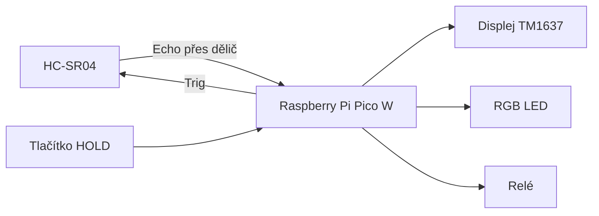
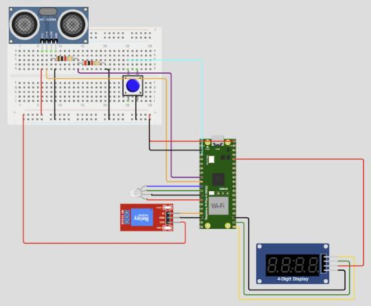
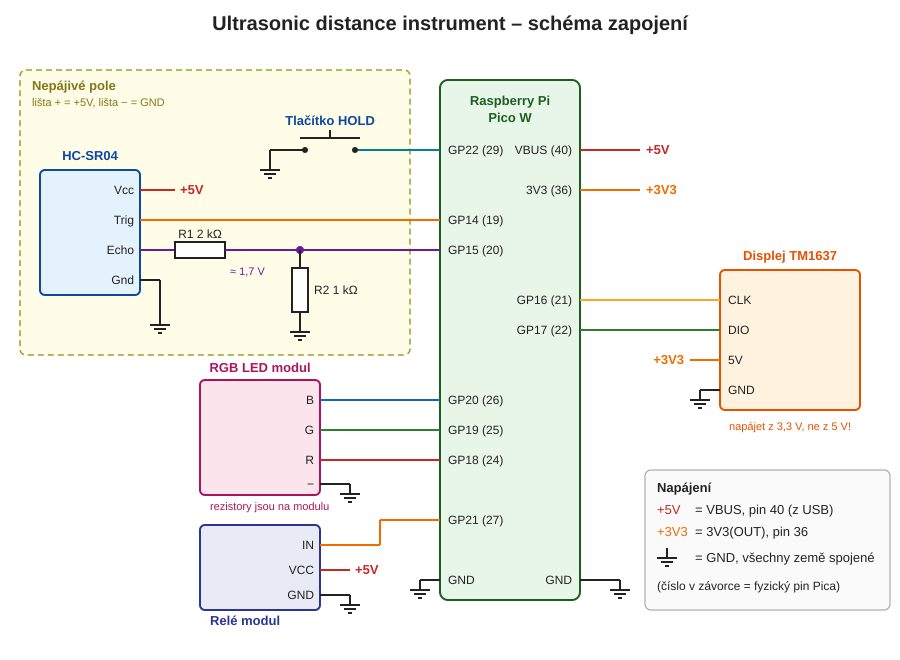

# Ultrasonic distance instrument

## Tým

| Člen | Zodpovědnost |
| :--- | :--- |
| **Marcel Hrbáček** | HC-SR04, dělič napětí a zapojení na nepájivém poli |
| **Matěj Dostál** | Displej TM1637 a tlačítko |
| **Matouš Dorazil** | RGB LED, relé a hlavní program |

## Návrh projektu

Bezkontaktní měřič vzdálenosti s Raspberry Pi Pico W. Funguje jako parkovací senzor:

- měří vzdálenost ultrazvukovým senzorem HC-SR04 10× za sekundu,
- zobrazuje vzdálenost v cm na 4místném displeji – pod 100 cm s jedním desetinným místem, jako desetinná
  čárka slouží dvojtečka displeje (např. `29:6` = 29,6 cm), od 100 cm celé číslo,
- RGB LED ukazuje vzdálenost barvou: zelená od 50 cm, fialová 30–50 cm, červená pod 30 cm
  (původně žlutá, ale ta na našem LED modulu nebyla vidět),
- pod 30 cm sepne relé (např. výstražné světlo),
- tlačítko HOLD zmrazí hodnotu na displeji.

## Součástky

| Součástka | Typ |
| :--- | :--- |
| Řídicí deska | Raspberry Pi Pico W + rozšiřující deska |
| Ultrazvukový senzor | HC-SR04 |
| Displej | 4místný 7segmentový displej TM1637 |
| RGB LED | Iduino 3-color LED modul |
| Relé | 1 Relay Module SRD-05VDC-SL-C |
| Tlačítko | mikrospínač 12 × 12 mm |
| Rezistory | 1 kΩ + 2 kΩ (dělič napětí) |
| Nepájivé pole | HC-SR04, dělič, tlačítko, rozvod 5 V a GND |

## Blokové schéma

## Zapojení

### Schéma zapojení

### Simulace ve Wokwi

Simulace: **https://wokwi.com/projects/481664234164703233** (zdroj schématu: [`wokwi/diagram.json`](wokwi/diagram.json))

### Piny Raspberry Pi Pico W

Všechny signály jsou v sekci **Digital** rozšiřující desky – u každého GPIO je trojice pinů **D / 3V3 / GND**,
signál se zapojuje do zeleného pinu **D**.

| Pin Pica | Fyzický pin | Připojeno k | Poznámka |
| :--- | :---: | :--- | :--- |
| GP14 | 19 | HC-SR04 Trig | |
| GP15 | 20 | HC-SR04 Echo | **přes dělič**: 2 kΩ od Echo, 1 kΩ k zemi |
| GP16 | 21 | TM1637 – CLK | |
| GP17 | 22 | TM1637 – DIO | |
| GP18 | 24 | RGB LED – R | |
| GP19 | 25 | RGB LED – G | |
| GP20 | 26 | RGB LED – B | |
| GP21 | 27 | Relé – IN | |
| GP22 | 29 | Tlačítko HOLD | druhá strana tlačítka na GND |
| VBUS (5 V) | 40 | HC-SR04 Vcc, relé VCC | |
| 3V3(OUT) | 36 | TM1637 – 5V | displej napájet z 3,3 V |
| GND | 3, 8, 13, 18, 23, 28, 33, 38 | GND všech součástek | všechny země spojené |

**Bezpečnost:** piny Pica snesou jen 3,3 V, proto má Echo z HC-SR04 (5 V) dělič napětí.
Relé spíná jen malé napětí, žádných 230 V.

## Plán časování

Program používá `asyncio`: úlohy se střídají a žádná dlouho neblokuje ostatní.

| Úloha | Perioda | Co dělá |
| :--- | :---: | :--- |
| měření | 100 ms | změří vzdálenost, nastaví LED a relé |
| displej | 200 ms | zobrazí vzdálenost |
| tlačítko | 20 ms | čte tlačítko, přepíná HOLD |

HC-SR04 se nemá spouštět častěji než po 60 ms, jinak zachytí ozvěnu předchozího měření, proto 100 ms.

## Software

**MicroPython:** v1.29.0 (firmware `RPI_PICO_W`, vydáno 24. 8. 2026) na našem Pico W. Simulace Wokwi používá v1.28.0,
rozdíl na projekt nemá vliv.
Firmware: https://micropython.org/download/RPI_PICO_W/

**Použité knihovny** – jen vestavěné moduly MicroPythonu, nic se nemusí instalovat:

| Knihovna | K čemu ji používáme |
| :--- | :--- |
| `machine` | `Pin` (ovládání GPIO), `time_pulse_us` (měření délky pulzu Echo) |
| `time` | `sleep_us`, `sleep_ms` (krátké čekání, 10 µs pulz pro Trig) |
| `asyncio` | souběžné úlohy (měření, displej, tlačítko) |

**Vlastní moduly** (`src/`): `hcsr04.py`, `tm1637.py`, `rgb_led.py`, `relay.py`,
`config.py`, `main.py`. 

**Vývojové prostředí:** VS Code + rozšíření MicroPico (nahrávání kódu do Pica), dokumentace Sphinx (jen na PC).

#### HC-SR04 – výsledky měření

Měřeno proti pevné kolmé překážce, vzdálenost změřena metrem od čela kovových válečků senzoru.
Hodnoty jsou z displeje a konzole při běhu `main.py`, bez kalibrace.

| Skutečná vzdálenost | Naměřeno | Chyba |
| :---: | :---: | :---: |
| 10 cm | 10,0 cm | 0,0 cm |
| 30 cm | 29,6 cm | −0,4 cm |
| 50 cm | 49,1 cm | −0,9 cm |
| 70 cm | 69,3 cm | −0,7 cm |
| 90 cm | 89,4 cm | −0,6 cm |

- Senzor měří s chybou **do 1 cm** (průměrná absolutní chyba 0,5 cm) v rozsahu 10–90 cm, kalibrace není potřeba.
- První měření ukazovalo offset asi +5 cm. Kontrolní měření ho nepotvrdilo – šlo o chybu měření
  (malá nebo šikmá překážka, vzdálenost měřená od jiného místa než od čela válečků).
- Mírné podhodnocení (asi −0,6 %) odpovídá teplotní závislosti rychlosti zvuku – kód počítá s 343 m/s (20 °C).
- Kalibrace je v `config.py` vypnutá (`CAL_SCALE = 1.0`, `CAL_OFFSET_CM = 0.0`), třída `HCSR04` ji ale umí.

