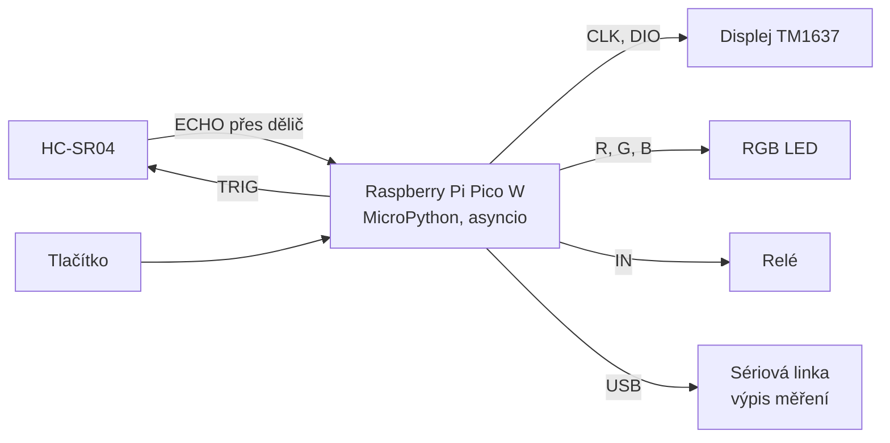

# Ultrasonic distance instrument

Bezkontaktní měřič vzdálenosti s ultrazvukovým senzorem HC-SR04 na **Raspberry Pi Pico W** v **MicroPythonu**.
Vzdálenost se zobrazuje na 4místném displeji, RGB LED ukazuje blízko/daleko a když je překážka moc blízko,
sepne relé (např. výstražné světlo). Teplota ze senzoru BME280 zpřesňuje výpočet rychlosti zvuku.

> Projekt do kurzu MicroPython, téma 6 – *Ultrasonic distance instrument*.

---

## 1. O projektu

- **Problém:** Bezkontaktní měření vzdálenosti k překážce a jasná indikace „blízko / daleko“ (jako parkovací senzor).
- **Klíčová funkce (minimum):** Měření vzdálenosti 10× za sekundu, zobrazení v cm na displeji TM1637
  a barevná indikace RGB LED (zelená / žlutá / červená).
- **Rozšíření (až po splnění minima):**
  - relé sepne při vzdálenosti pod 30 cm (prahový alarm),
  - korekce rychlosti zvuku podle teploty z BME280,
  - tlačítko přepíná displej mezi vzdáleností a teplotou.

## 2. Tým a rozdělení odpovědností

| Člen | zodpovědnost |
| :--- | :--- |
| **Marcel Hrbáček** | Github |
| **Matěj Dostál** | visualstudio |
| **Matouš Dorazil** | Blokové schéma |

## 3. Hardware

| Komponenta | Typ / označení | Počet | Poznámka |
| :--- | :--- | :---: | :--- |
| Řídicí deska | Raspberry Pi Pico W + rozšiřující deska | 1 | logika 3,3 V |
| Ultrazvukový senzor | HC-SR04 | 1 | napájení 5 V, rozsah 2–400 cm, ECHO má 5 V |
| Dělič napětí | rezistory 1 kΩ + 2 kΩ | 1 sada | ECHO 5 V → ~3,3 V pro Pico |
| Displej | 4místný 7segmentový displej s TM1637 | 1 | piny CLK, DIO, GND, 5V – napájet z **3,3 V** |
| RGB LED | Iduino 3-color LED modul | 1 | společná katoda, rezistory na modulu (piny R, G, B, −) |
| Relé | 1 Relay Module, SRD-05VDC-SL-C | 1 | napájení 5 V, ovládání pinem IN |
| Tlačítko | mikrospínač 12 × 12 mm | 1 | proti GND, interní pull-up |
| Ostatní | nepájivé pole, propojovací vodiče, USB kabel | – | |

## 4. Návrh

### 4.1 Blokové schéma

