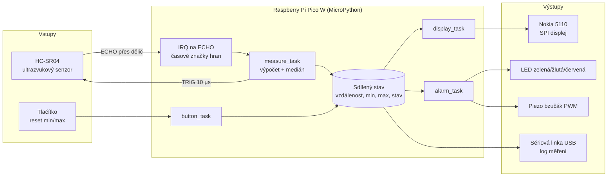

# Ultrasonic distance instrument

Bezkontaktní měřič vzdálenosti s ultrazvukovým senzorem HC-SR04 na **Raspberry Pi Pico W** v **MicroPythonu**.
Funguje jako opticko-akustický parkovací senzor: měří vzdálenost v pevném intervalu, zobrazuje ji na displeji
a signalizuje přiblížení LED diodami a bzučákem.

> Projekt do kurzu MicroPython (téma 6 – *Ultrasonic distance instrument*).

---

## 1. O projektu

- **Problém:** Bezkontaktní měření vzdálenosti k překážce v reálném čase a srozumitelná indikace „blízko / daleko“.
- **Klíčová funkce (minimum):** Měření vzdálenosti každých 60 ms, zobrazení hodnoty na displeji Nokia 5110
  a vizuální indikace blízko/daleko (zelená / žlutá / červená LED).
- **Rozšíření (až po splnění minima):**
  - prahový alarm s bzučákem, který pípá tím rychleji, čím je překážka blíž (parkovací senzor),
  - sledování minimální a maximální naměřené vzdálenosti (reset tlačítkem),
  - sloupcový graf vzdálenosti na displeji.

## 2. Tým a rozdělení odpovědností

> Návrh rozdělení – upravte podle dohody. Každý člen musí rozumět celému systému.

| Člen | Hlavní zodpovědnost | Další |
| :--- | :--- | :--- |
| **Marcel Hrbáček** | Senzor HC-SR04: třída `HCSR04`, dělič napětí, měření přesnosti a rozsahu | Testy senzoru, měření do dokumentace |
| **Matěj Dostál** | Displej Nokia 5110: třída `PCD8544`, uživatelské rozhraní (`ui.py`) | Schéma zapojení, poster |
| **Matouš Dorazil** | Alarm (`alarm.py`), integrace v `main.py`, plán časování (`asyncio`) | Sphinx dokumentace, video |

## 3. Hardware

| Komponenta | Typ / označení | Počet | Poznámka |
| :--- | :--- | :---: | :--- |
| Řídicí deska | Raspberry Pi Pico W | 1 | MicroPython, logika 3,3 V |
| Ultrazvukový senzor | HC-SR04 | 1 | Napájení 5 V, rozsah ~2–400 cm, výstup ECHO má úroveň 5 V |
| Dělič napětí | rezistory 1 kΩ + 2 kΩ | 1 sada | ECHO 5 V → ~3,3 V pro GPIO Pica |
| Displej | Nokia 5110 (řadič PCD8544), SPI | 1 | 84 × 48 px, napájení 3,3 V |
| LED | zelená, žlutá, červená | 3 | každá s rezistorem 330 Ω |
| Bzučák | pasivní piezo bzučák | 1 | řízený PWM; magnetický bzučák jen přes tranzistor |
| Tlačítko | mikrospínač | 1 | reset min/max, interní pull-up |
| Ostatní | nepájivé pole, vodiče, USB kabel | – | |

**Ověřit s vyučujícím před schválením:**
- jestli je k dispozici HC-SR04 (5 V), nebo HC-SR04P (3,3 V, ten nepotřebuje dělič),
- dostupnost displeje Nokia 5110 a typ bzučáku (pasivní/aktivní, piezo/magnetický).

## 4. Návrh

### 4.1 Blokové schéma



### 4.2 Zapojení (pin/bus plán)

| Signál | Pico W GPIO | Fyzický pin | Poznámka |
| :--- | :--- | :---: | :--- |
| HC-SR04 VCC | VBUS (5 V z USB) | 40 | senzor potřebuje 5 V |
| HC-SR04 GND | GND | 38 | společná zem |
| HC-SR04 TRIG | GP14 | 19 | výstup, 3,3 V stačí na spuštění |
| HC-SR04 ECHO | GP15 | 20 | **přes dělič:** ECHO → 1 kΩ → GP15, GP15 → 2 kΩ → GND |
| Nokia 5110 VCC | 3V3(OUT) | 36 | |
| Nokia 5110 GND | GND | 23 | |
| Nokia 5110 CLK | GP18 (SPI0 SCK) | 24 | |
| Nokia 5110 DIN | GP19 (SPI0 TX/MOSI) | 25 | |
| Nokia 5110 CE | GP17 (SPI0 CSn) | 22 | |
| Nokia 5110 DC | GP20 | 26 | |
| Nokia 5110 RST | GP21 | 27 | |
| Nokia 5110 BL | GP22 | 29 | podsvícení (volitelné, ověřit polaritu modulu) |
| LED zelená | GP10 | 14 | přes 330 Ω na GND |
| LED žlutá | GP11 | 15 | přes 330 Ω na GND |
| LED červená | GP12 | 16 | přes 330 Ω na GND |
| Bzučák | GP13 (PWM) | 17 | pasivní piezo; druhý vývod na GND |
| Tlačítko | GP16 | 21 | proti GND, interní pull-up |

**Bezpečnost:** GPIO Pica snese jen 3,3 V. ECHO z HC-SR04 (5 V) se proto nikdy nepřipojuje přímo, ale přes
dělič (5 V · 2/3 ≈ 3,3 V). Všechny zemi jsou společné. Bzučák s vyšším odběrem (magnetický) se spíná přes NPN
tranzistor s ochrannou diodou.

Všechny piny jsou definované na jednom místě, v [`src/config.py`](src/config.py).

### 4.3 Softwarové moduly

| Soubor | Obsah | Role |
| :--- | :--- | :--- |
| `src/config.py` | konstanty | piny, prahy vzdálenosti, periody úloh |
| `src/hcsr04.py` | třída `HCSR04` | driver senzoru; neblokující měření pomocí přerušení |
| `src/pcd8544.py` | třída `PCD8544` | driver displeje Nokia 5110 (framebuffer + SPI) |
| `src/alarm.py` | třída `Alarm` | LED a bzučák, úrovně alarmu, neblokující rytmus pípání |
| `src/ui.py` | třída `Screen` | rozvržení obrazovky (hodnota, sloupcový graf, min/max, chyby) |
| `src/main.py` | aplikace | `asyncio` úlohy, filtr, sdílený stav, ošetření chyb |
| `tests/` | testy komponent | samostatné ověření každé komponenty na Picu |

### 4.4 Plán časování a souběhu

Program běží na `asyncio` (kooperativní multitasking). Žádná úloha neobsahuje dlouhé blokující čekání.

| Činnost | Interval | Jak běží | Zodpovědnost |
| :--- | :---: | :--- | :--- |
| Přerušení na pinu ECHO | událost | hard IRQ, obě hrany | jen uloží `ticks_us()` náběžné a sestupné hrany a nastaví příznak |
| `measure_task` | 60 ms | `asyncio` úloha | vyšle TRIG, po 60 ms přečte výsledek, spočítá cm, medián z 5 vzorků, min/max |
| `display_task` | 100 ms (10 Hz) | `asyncio` úloha | vykreslí obrazovku do framebufferu a pošle ji po SPI (~1 ms) |
| `alarm_task` | 20 ms | `asyncio` úloha | podle vzdálenosti nastaví úroveň alarmu, řídí LED a rytmus bzučáku |
| `button_task` | 20 ms | `asyncio` úloha | čtení tlačítka s odrušením zákmitů, reset min/max |
| `log_task` | 1 s | `asyncio` úloha | výpis měření na sériovou linku (data pro testování) |

**Proč takto:**
- Proč 60 ms: výrobce doporučuje mezi měřeními aspoň 60 ms, aby se nezachytila ozvěna předchozího pulzu. Nejdelší
  ECHO pulz (bez překážky) trvá ~38 ms, takže výsledek je vždy hotový před dalším spuštěním.
- Proč přerušení místo `machine.time_pulse_us()`: `time_pulse_us()` blokuje až desítky ms, a tím by zastavil displej
  i alarm. Hard IRQ zaznamená čas hrany s přesností na µs i během posílání dat na displej. Výpočet vzdálenosti se dělá
  až v běžném kódu, ne v přerušení.
- Proč displej jen 10 Hz: rychlejší obnova by oko nepostřehlo a zbytečně by zatěžovala procesor.

### 4.5 Ošetření chyb

| Situace | Detekce | Projev |
| :--- | :--- | :--- |
| Senzor odpojený / špatně zapojený | po TRIG nepřijde náběžná hrana ECHO | displej „CHYBA SENZ.“, blikající žlutá LED |
| Mimo rozsah / žádná překážka | ECHO nedokončeno nebo hodnota mimo 2–400 cm | displej „MIMO ROZSAH“ |
| Displej nefunguje | výjimka při inicializaci | chyba na sériové lince, měření a alarm běží dál |
| Ojedinělé chybné vzorky | medián z posledních 5 měření | odfiltrováno |

## 5. Instalace a spuštění

1. Nahrajte do Pico W firmware MicroPython (verze 1.22 nebo novější) podle
   [oficiálního návodu](https://micropython.org/download/RPI_PICO_W/).
2. Zapojte hardware podle tabulky v kapitole 4.2.
3. Nahrajte všechny soubory ze složky `src/` do kořene Pica, např. v Thonny (*Upload to /*) nebo pomocí `mpremote`:
   ```bash
   mpremote cp src/config.py src/hcsr04.py src/pcd8544.py src/alarm.py src/ui.py src/main.py :
   ```
4. Restartujte Pico. `main.py` se spustí automaticky a měření se průběžně vypisuje na sériovou linku.

Projekt nepoužívá žádné externí MicroPython knihovny, jen vestavěné moduly `machine`, `framebuf`, `asyncio` a `time`.

### Testy komponent

Každou komponentu lze otestovat samostatně. Nahrajte driver a `config.py` a spusťte test, například:

```bash
mpremote cp src/config.py src/hcsr04.py : + run tests/test_hcsr04.py
```

## 6. Dokumentace (Sphinx)

Zdrojové soubory dokumentace jsou ve složce `docs/`. Lokální sestavení:

```bash
pip install -r docs/requirements.txt
```

```bash
sphinx-build -b html docs docs/_build/html
```

Výsledek je v `docs/_build/html/index.html`.

## 7. Testování a výsledky

*Doplní se ve 4. týdnu:* přesnost a rozsah senzoru (porovnání s metrem), rozptyl měření, skutečná perioda měření
a obnovy displeje, chování při chybách, fotky prototypu.

## 8. Prezentace

- Poster: *(odkaz doplnit)*
- Video (1–2 min): *(odkaz doplnit)*

## 9. Týdenní pokrok

### Týden 1 – návrh a architektura
- [x] Výběr tématu a klíčové funkce
- [x] Seznam komponent, pin/bus plán, plán časování
- [x] Struktura repozitáře a kostra tříd
- [ ] Schválení návrhu a hardwaru vyučujícím
- [ ] Potvrzení rozdělení rolí v týmu

### Týden 2 – moduly zařízení (plán)
- [ ] Otestovat HC-SR04 samostatně (`tests/test_hcsr04.py`), změřit přesnost
- [ ] Otestovat displej (`tests/test_display.py`)
- [ ] Otestovat LED a bzučák (`tests/test_alarm.py`)
- [ ] Aktualizovat schéma zapojení podle skutečného stavu, doplnit dokumentaci tříd

## 10. Licence

Kód je pod licencí MIT, viz [LICENSE](LICENSE). Projekt nepoužívá žádný kód třetích stran. Pokud bude převzat
kód z cvičení nebo z jiného zdroje, bude zde uveden zdroj a jeho licence.
