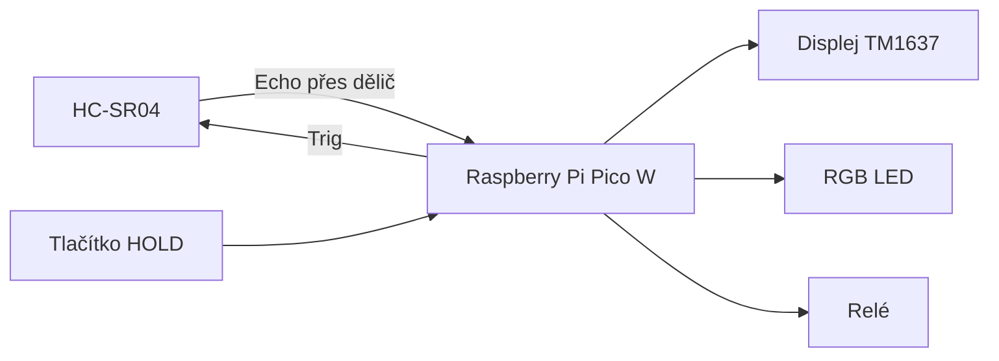

# Ultrasonic distance instrument

Projekt do kurzu MicroPython, téma 6 – *Ultrasonic distance instrument*.
**Týden 1 – návrh a architektura.**

## Tým

| Člen | Zodpovědnost |
| :--- | :--- |
| **Marcel Hrbáček** | HC-SR04, dělič napětí a zapojení na nepájivém poli |
| **Matěj Dostál** | Displej TM1637 a tlačítko |
| **Matouš Dorazil** | RGB LED, relé a hlavní program |

## Návrh projektu

Bezkontaktní měřič vzdálenosti s Raspberry Pi Pico W. Funguje jako parkovací senzor:

- měří vzdálenost ultrazvukovým senzorem HC-SR04 10× za sekundu,
- zobrazuje vzdálenost v cm na 4místném displeji,
- RGB LED ukazuje vzdálenost barvou: zelená nad 100 cm, žlutá 30–100 cm, červená pod 30 cm,
- pod 30 cm sepne relé (např. výstražné světlo),
- tlačítko HOLD zmrazí hodnotu na displeji.

## Součástky

| Součástka | Typ |
| :--- | :--- |
| Řídicí deska | Raspberry Pi Pico W + rozšiřující deska |
| Ultrazvukový senzor | HC-SR04 |
| Displej | 4místný 7segmentový displej TM1637 |
| RGB LED | Iduino 3-color LED modul |
| Relé | 1 Relay Module SRD-05VDC-SL-C |
| Tlačítko | mikrospínač 12 × 12 mm |
| Rezistory | 1 kΩ + 2 kΩ (dělič napětí) |
| Nepájivé pole | HC-SR04, dělič, tlačítko, rozvod 5 V a GND |

## Blokové schéma



## Zapojení

Schéma ve Wokwi: **https://wokwi.com/projects/480396275911174145**

| Součástka – pin | Pico W | Poznámka |
| :--- | :--- | :--- |
| HC-SR04 Vcc | VBUS (5 V) | přes lištu + na nepájivém poli |
| HC-SR04 Trig | GP7 | |
| HC-SR04 Echo | GP6 | přes dělič 1 kΩ + 2 kΩ (5 V → 3,3 V) |
| HC-SR04 Gnd | GND | přes lištu − na nepájivém poli |
| TM1637 CLK / DIO | GP16 / GP17 | |
| TM1637 5V | **3V3** | napájet z 3,3 V, ne z 5 V |
| RGB LED B / G / R | GP8 / GP9 / GP10 | pin − na GND |
| Relé IN | GP13 | VCC na 5 V, GND na GND |
| Tlačítko | GP2 a GND | interní pull-up |

**Bezpečnost:** piny Pica snesou jen 3,3 V, proto má Echo z HC-SR04 (5 V) dělič napětí.
Relé spíná jen malé napětí, žádných 230 V.

## Plán časování

Program používá `asyncio`: úlohy se střídají a žádná dlouho neblokuje ostatní.

| Úloha | Perioda | Co dělá |
| :--- | :---: | :--- |
| měření | 100 ms | změří vzdálenost, nastaví LED a relé |
| displej | 200 ms | zobrazí vzdálenost |
| tlačítko | 20 ms | čte tlačítko, přepíná HOLD |

HC-SR04 se nemá spouštět častěji než po 60 ms, jinak zachytí ozvěnu předchozího měření, proto 100 ms.

## Struktura repozitáře

```
projekt/projektde/
├── src/      config.py, hcsr04.py, tm1637.py, rgb_led.py, relay.py, main.py
├── tests/    test každé součástky zvlášť (2. týden)
└── docs/     Sphinx dokumentace
wokwi/        schéma pro simulátor Wokwi
```

Každá součástka má vlastní třídu, všechny piny jsou v `config.py`.

## Pokrok

### Týden 1 – návrh a architektura
- [x] Téma a klíčová funkce
- [x] Seznam součástek
- [x] Blokové schéma a zapojení (Wokwi)
- [x] Plán časování
- [x] Struktura repozitáře a třídy součástek
- [ ] Schválení návrhu vyučujícím

### Týden 2 – plán
- [ ] Otestovat každou součástku samostatně na skutečném hardwaru
